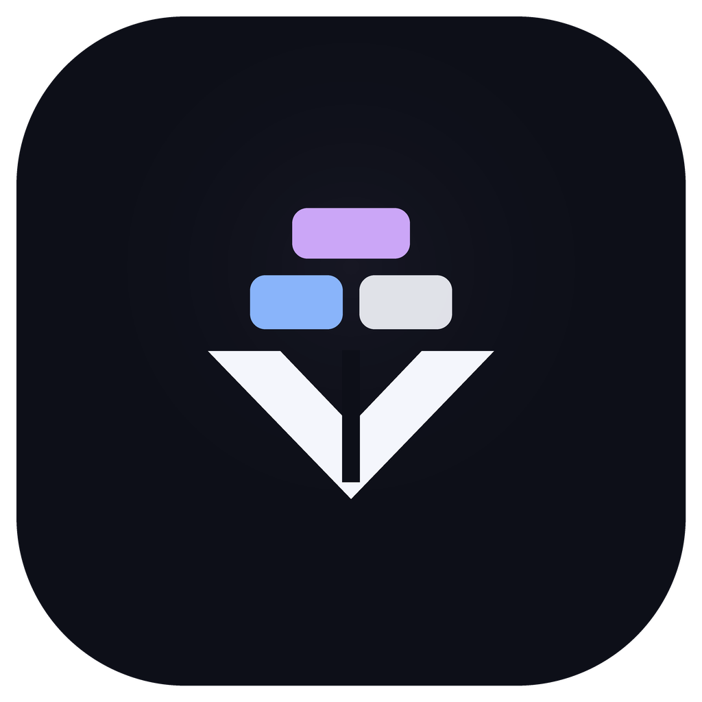

<p align="center">
  
</p>

<h1 align="center">Vessel</h1>

<p align="center">
  <em>Most <strong>ships</strong> dread <strong>Rust</strong>. This <strong>cargo vessel</strong> runs on it — <strong>shipped</strong> with <strong>Cargo</strong>, engineered not to <strong>rust</strong>, <strong>docking</strong> plugins by <strong>manifest</strong> at local <strong>ports</strong>.</em>
</p>

<p align="center">
  <a href="https://github.com/falsisdev/vessel/releases">Releases</a> ·
  <a href="https://github.com/falsisdev/vessel/wiki">Documentation Wiki</a> ·
  <a href="https://github.com/falsisdev/vessel/wiki/Home-tr">Türkçe Wiki</a> ·
  <a href="docs/wiki/Home.md">Offline Docs (<code>docs/wiki/</code>)</a> ·
  <a href="LICENSE">GPL-3.0 License</a>
</p>

**Vessel** is a local-first, cross-platform streaming and media center built from the ground up in **Rust**, **Tauri v2**, **Vue 3 / TypeScript**, and **Kotlin Jetpack Compose (`UniFFI`)**.

> **Project Status (`v0.1.3`):** Core Engine (`crates/vessel-*`), the **Desktop App (`apps/desktop`)** for macOS, Windows & Linux, and the **Android App (`apps/android` via `vessel-ffi` UniFFI)** are active and downloadable on [GitHub Releases](https://github.com/falsisdev/vessel/releases). Next major milestones include cloud device sync, tracker scrobbling (Simkl/Trakt/AniList/MAL/Kitsu), Android TV remote navigation, and iOS/iPadOS.
> The earlier Go + SwiftUI prototype is preserved on `archive/v1-go` (`v1-go-archive` tag) and `archive/v1-go-ui-polish` (`v1-go-ui-polish-archive` tag).

---

## Core Principles

- **Local-First & Zero Server Cost:** Plugin execution, SQLite library state, watch progress, metadata caching, skip-segment lookup, offline downloads, and the local HTTP/HLS proxy (`127.0.0.1`) all run directly on your device. Zero telemetry.
- **Replaceable Shell, Permanent Brain:** All business logic lives inside UI-agnostic Rust crates (`vessel-engine` and workspace crates), keeping UI shells thin and portable across Desktop, Android, and iOS.
- **Self-Contained Plugins + Optional Metadata Enrichment:** Community TypeScript/JavaScript plugins (`rquickjs` + `oxc`) work without external IDs (TMDB/IMDb/AniList) to list episodes or resolve streams, while optional background enrichment adds artwork, synopses, AniZip episode stills/titles, skip segments, and `(season, episode) ↔ absolute_episode` alignment.
- **CloudStream / Nuvio-Grade UX:** Source resolution before playback, full-screen HUD player with skip buttons and gestures, Smart Continue Watching, Fix Match manual ID overrides, built-in IPTV + XMLTV EPG, and concurrent offline HLS/range downloads.

---

## Implemented Features

### Core Engine & Runtime (Rust)
- **Isolated JS/TS Plugin Runtime (`vessel-plugin-rt`):** Powered by `rquickjs` + `oxc` TypeScript stripping with SQLite compile caching, ES6 module loading (local Dev Mode directories & `.plugin.vessel` zip packages), per-sandbox resource limits (`32 MiB` heap ceiling, `512 KiB` stack, `15s` execution watchdog), an LRU warm plugin pool (`18` plugins, `5-minute` idle TTL), Nuvio scraper compatibility shims (`cheerio`, `axios`, `CryptoJS`, `fetch`), and parallel streaming search with cancellation.
- **Built-in Plugin SDK (`vessel.*`):** `vessel.http` (with DNS-resolved SSRF protection and per-domain user permission prompts), `vessel.html.parse` (`scraper` CSS selectors), `vessel.crypto` (AES-CBC/GCM/CTR/ECB, HMAC-SHA256, MD5/SHA1/SHA256, RC4, Hex/Base64), `vessel.storage` (isolated KV + `settingsSchema` values), `vessel.unpack` (Dean Edwards P.A.C.K.E.R), and `vessel.evalWithEnv`.
- **Local HTTP / HLS Proxy (`vessel-proxy`):** Binds `127.0.0.1:0` using `axum` + `reqwest` (`rustls`), ephemeral stream tokens, `HMAC-SHA256` signed sub-URLs (open-relay protected), HTTP `206` Range pass-through, `.m3u8` playlist rewriting (`#EXT-X-KEY`, `#EXT-X-MAP`, `#EXT-X-MEDIA`), offline loopback file serving with path-traversal guards, and Smart Proxy header injection.
- **Metadata & Skip-Segment Engine (`vessel-metadata`):** Zero-key **AniList**, **Cinemeta (IMDb)**, **MyAnimeList (Jikan)**, **Kitsu**, and **AniZip** enrichment plus optional **TMDB** API key & **Simkl** Client ID support, interactive 6-provider **Fix Match** title search & manual ID overrides, `(season, episode) ↔ absolute_episode` coordinate translation, and multi-source skip segments (**`Plugin > TheIntroDB > IntroDB > AniSkip`**) supporting **Intro**, **Recap**, **Credits**, and **Preview** with duration, season, confidence, and negative-flag guards.
- **Persistence & Backups (`vessel-storage`):** `rusqlite` (`bundled` + `WAL` + `FTS5`) single-writer actor managing library watch statuses, dual-coordinate watch progress, episode snapshots for automatic next-episode advancement, settings, domain grants, metadata cache, IPTV channels, and `.backup.vessel` JSON export/import (`Merge` & `Overwrite`).
- **IPTV & EPG (`vessel-iptv`):** Xtream Codes & M3U+ playlist ingestion, XMLTV EPG parsing (Now/Next), custom per-profile `User-Agent`, and instant SQLite `FTS5` channel search.
- **Offline Downloader (`vessel-downloader`):** Concurrent HTTP `Range` multipart chunk downloads + resume, 8-worker parallel HLS segment downloader with AES-128 decryption, master `EXT-X-MEDIA` audio & subtitle playlist bundling, parallel external subtitle downloads, cooperative instant `pause` / `delete` cancellation, drag-and-drop queue priority reordering, and configurable download folder.
- **External `mpv` Backend (`vessel-player-mpv`):** JSON IPC controller (`time-pos`, `eof`, `sub-add`, `sub-delay`) for native `mpv` handoff when `mpv` is installed.

### Desktop (`apps/desktop`) & Android (`apps/android`) Applications
- **Nuvio-Inspired Cinema Home:** Opaque cargo-ship-to-bow-logo splash reveal, crossfading spotlight hero with smooth **Ken Burns zoom**, customizable Hero mode (`Full` / `Compact` / `Hidden`) & sources, distinct **Watch Now** (direct stream resolution) vs **More Info** actions, drag-and-drop shelf ordering, **Smart Continue Watching** with manual progress editor, and VOD-only Home isolation (keeping Live TV dedicated to the Live TV screen).
- **Full-Screen CloudStream-Style Player:** Auto-hiding HUD, screen lock, one-click **Skip Intro / Recap / Credits / Preview**, direct **Go to Details** (automatically omitted for Live TV), in-player **Episodes / Channels**, live **Sources** switcher (including cross-plugin linked sources), multi-track **Audio**, **Subtitles & Sync** (`-500ms / +500ms`) with full styling, gestures, external **MPV** handoff on Desktop, and landscape **Media3 ExoPlayer** on Android.
- **Rich Details, Fix Match & Multi-Source Linking:** Atmospheric backdrop, external ID badges (`TMDB`, `IMDb`, `Simkl`, `AniList`, `MAL`, `Kitsu`), top-right `⋮` actions menu with 6-provider **Fix Match** title search and per-media **Include Streams From Other Sources** (saved per device so streams from another enabled plugin merge into the same Details page), 3 episode view modes, CloudStream-style **Source Resolver**, and **Quick Watch Status** card menus.
- **4-Level Offline Downloads Manager:** Hierarchical **`Content → Season → Episode → Streams`** tree (`Content → Streams` for movies), expandable rows with stream-label offline playback, dedicated offline **Continue Watching** rail, drag-and-drop **Download Queue** reordering, instant Pause/Resume/Delete, and configurable storage directory.
- **Live TV (`Live TV Plugins` + `M3U/Xtream` + `EPG`):** Live TV Plugins tab first with unlimited channels/categories, unified **Favorites** bar pinned at the top upon opening, configurable Live TV layout (**Grid**, **Compact List**, **Large Tiles**, columns, density, logos/category toggles), drag-and-drop plugin & category ordering, and direct-to-player streaming.
- **Customization & Updater:** **12 built-in languages**, **5 built-in themes** (+ **Dynamic Material You** on Android, `.theme.vessel` import), modular navigation (including **Floating Bottom Navbar** toggle on both Desktop & Android), live subtitle preview, custom CSS injection on Desktop, built-in **GitHub Release auto-updater** (`.dmg`, `.exe`, `.apk`), and `.backup.vessel` export/import.

---

## Player Shortcuts & Touchpad Controls

| Action | Keyboard | Touchpad Gesture |
| :--- | :--- | :--- |
| Play / Pause | `Space` or `K` | — |
| Seek `-10s` / `+10s` | `←` / `J` and `→` / `L` | Two-finger horizontal swipe |
| Volume Up / Down | `↑` / `↓` | Two-finger vertical swipe |
| Mute / Unmute | `M` | — |
| Fill / Fit Screen | — | Two-finger pinch (`Ctrl + wheel`) |
| Fullscreen | `F` | — |
| Close Drawer / Unlock / Exit | `Esc` | — |

> **macOS Tip:** Enable **Natural Touchpad Scrolling** under **Settings → Playback & Privacy** if horizontal seek or vertical volume feels inverted on your trackpad.

---

## Documentation & Multilingual Wiki

Comprehensive user guides, architecture internals, keyboard shortcuts, and Plugin SDK manuals are available in the **GitHub Wiki** and mirrored inside [`docs/wiki/`](docs/wiki/Home.md):

- **English (Primary):** [Wiki Home](https://github.com/falsisdev/vessel/wiki) · [Installation](https://github.com/falsisdev/vessel/wiki/Installation-and-Setup) · [User Guide](https://github.com/falsisdev/vessel/wiki/Desktop-App-User-Guide) · [Player & Skip Segments](https://github.com/falsisdev/vessel/wiki/Player-Controls-and-Skip-Segments) · [Offline Downloads](https://github.com/falsisdev/vessel/wiki/Offline-Downloads-and-Queue) · [Live TV & EPG](https://github.com/falsisdev/vessel/wiki/Live-TV-IPTV-and-EPG) · [Metadata & Episode Sync](https://github.com/falsisdev/vessel/wiki/Metadata-and-Episode-Sync) · [Extensions & Repos](https://github.com/falsisdev/vessel/wiki/Extensions-and-Repositories) · [Plugin Development SDK](https://github.com/falsisdev/vessel/wiki/Plugin-Development-SDK) · [Architecture](https://github.com/falsisdev/vessel/wiki/Architecture-and-Crates) · [Themes, i18n & Privacy](https://github.com/falsisdev/vessel/wiki/Themes-Localization-and-Privacy)
- **Multilingual Hubs:** [Türkçe](https://github.com/falsisdev/vessel/wiki/Home-tr) · [Español](https://github.com/falsisdev/vessel/wiki/Home-es) · [Deutsch](https://github.com/falsisdev/vessel/wiki/Home-de) · [Français](https://github.com/falsisdev/vessel/wiki/Home-fr) · [Italiano](https://github.com/falsisdev/vessel/wiki/Home-it) · [Русский](https://github.com/falsisdev/vessel/wiki/Home-ru) · [日本語](https://github.com/falsisdev/vessel/wiki/Home-ja) · [Português](https://github.com/falsisdev/vessel/wiki/Home-pt) · [中文](https://github.com/falsisdev/vessel/wiki/Home-zh) · [العربية](https://github.com/falsisdev/vessel/wiki/Home-ar) · [فارسی](https://github.com/falsisdev/vessel/wiki/Home-fa)

---

## Workspace Layout

```text
vessel/
├── crates/
│   ├── vessel-domain       # Core models, VesselError, ports, SkipSegment, ThemeSpec, UiPreferences
│   ├── vessel-storage      # SQLite (WAL + FTS5) actor, watch progress, episode snapshots, backups, secrets
│   ├── vessel-proxy        # Local 127.0.0.1 HTTP/HLS & offline file proxy with HMAC-SHA256 signing
│   ├── vessel-plugin-rt    # QuickJS + oxc TS runtime, SDK bridges, Nuvio shims, SSRF & domain policy
│   ├── vessel-metadata     # AniList / TMDB / Cinemeta / AniZip + TheIntroDB/IntroDB/AniSkip skip segments
│   ├── vessel-iptv         # Xtream Codes, M3U+, XMLTV EPG, FTS5 channel search
│   ├── vessel-downloader   # Range resume & parallel AES-128 HLS offline downloader with instant cancel
│   ├── vessel-player-mpv   # mpv JSON IPC playback backend
│   ├── vessel-engine       # Pure-Rust VesselEngine facade orchestrating all subsystems
│   └── vessel-ffi          # UniFFI library powering Android native Kotlin bindings
├── apps/
│   ├── desktop/            # Tauri v2 + Vue 3 / TypeScript desktop application
│   └── android/            # Kotlin Jetpack Compose + Media3 ExoPlayer Android app
└── docs/
    └── wiki/               # Multilingual GitHub Wiki sources (English-first + 11 languages)
```

---

## Installation (Prebuilt Releases)

Prebuilt desktop installers for **macOS** (`.dmg` for Apple Silicon & Intel), **Windows** (`-setup.exe`), **Linux** (`.AppImage`, `.deb`, `.rpm`, and `.flatpak`), and **Android** (`.apk`) are published on the [GitHub Releases](https://github.com/falsisdev/vessel/releases) page.

### Linux Note (`.AppImage` & `.flatpak`)
- **AppImage:** Make executable with `chmod +x Vessel_*.AppImage` and launch directly.
- **Flatpak:** Install the downloaded bundle locally via `flatpak install --user Vessel_*.flatpak` and run `flatpak run dev.falsis.vessel`.
- **Debian / Ubuntu / Fedora:** Install `.deb` via `sudo apt install ./Vessel_*.deb` or `.rpm` via `sudo dnf install ./Vessel-*.rpm`.

### macOS Note ("Vessel is damaged and can't be opened")
Because Vessel is an open-source app distributed without a paid Apple Developer ID notarization certificate, macOS Gatekeeper flags downloaded `.dmg` apps with a quarantine attribute. After dragging **Vessel.app** into **Applications**, run this once in Terminal:

```bash
xattr -cr /Applications/Vessel.app
```

Then launch **Vessel** normally.

### Windows Note (SmartScreen)
If Windows SmartScreen shows *"Windows protected your PC"* on unsigned alpha/beta installers, click **More info → Run anyway**.

---

## Building from Source

### Prerequisites
- **Rust** (`1.89+`, `stable` toolchain via `rustup`)
- **Node.js** (`v20+`, tested with `v22`) & **pnpm** (`v10+`)
- **Tauri v2 system dependencies** (Xcode Command Line Tools on macOS; WebView2 + MSVC build tools on Windows; WebKitGTK on Linux)
- **Optional:** [`mpv`](https://mpv.io/) (`brew install mpv` on macOS) if you want to hand off playback from the built-in player to native external `mpv`.

### Run the Desktop App (Development)
```bash
pnpm install
pnpm --filter @vessel/desktop tauri dev
```

### Run Tests & Checks
```bash
# Check formatting
cargo fmt --all -- --check

# Run Clippy with strict warnings
cargo clippy --workspace --all-targets -- -D warnings

# Run all Rust workspace tests
cargo test --workspace

# Typecheck and build the Vue frontend
pnpm --filter @vessel/desktop build
```

---

## Plugin Development (Quick Overview)

Vessel loads **Dev Mode** plugins directly from a local folder (`manifest.json` + `index.ts`) via **Extensions → Inspect Source**, `.plugin.vessel` zip packages, `gh:owner/repo` / `gl:owner/repo`, HTTP/registry shortcodes (`registry.json` — e.g. `anthology` or `tr` → `gh:falsisdev/anthology`), `vessel://install?src=…`, and Nuvio scraper manifests.

A plugin exports an object (default export or `vessel.definePlugin(...)`):
- `getHomeFeed(cursor?)` — returns categorized `poster` or `landscape` shelves
- `search(query, filters, page)` — returns matching `MediaSummary` items
- `getDetails(nativeId)` — returns `MediaDetail`, optional `seasons`, and `episodes`
- `getSeasonEpisodes(nativeId, seasonId)` — optional lazy season loader
- `getStreams(streamId)` — returns playable `StreamCandidate[]`, `SubtitleTrack[]`, and optional `SkipSegment[]`

See the full [Plugin Development SDK](https://github.com/falsisdev/vessel/wiki/Plugin-Development-SDK) guide ([offline copy](docs/wiki/Plugin-Development-SDK.md)) for TypeScript types, `manifest.json` schemas, `vessel.*` APIs, and packaging instructions.

---

## Roadmap

- **Cloud Sync:** Google Drive account linking for cross-device library, watch progress, linked sources, and preferences sync.
- **Tracker Integration:** Bidirectional scrobbling, matching, library status edits, and auto-sync with **Simkl**, **Trakt**, **AniList**, **MyAnimeList**, and **Kitsu**.
- **Android TV:** Full D-pad focus & remote navigation experience built on shared `vessel-ffi` + Compose for TV.
- **Performance & Media Optimizations:** Expanded player/runtime optimizations and stream extractor polish.
- **iOS & iPadOS:** Native SwiftUI + `MPVKit` shell powered by `vessel-ffi` `.xcframework`.

---

## License

Vessel is licensed under the **GNU General Public License v3.0 (GPL-3.0)**. See [LICENSE](LICENSE) for the full license text.
