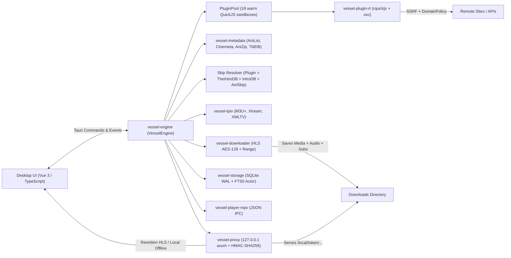

> 🌐 **English** · [Wiki Home](Home)

# Architecture & Rust Crates

Vessel strictly separates **core domain logic** (pure Rust) from **UI shells** (`Tauri v2` + `Vue 3`, and future `UniFFI` Android/iOS shells). This ensures zero business-logic duplication, deterministic testing, and high performance.

---

## High-Level Dataflow Diagram

---

## Workspace Crates Overview (10 Members)

| Crate / App | Role & Responsibilities |
| :--- | :--- |
| **`vessel-domain`** | Pure domain models (`MediaSummary`, `MediaDetail`, `Episode`, `StreamCandidate`, `SubtitleTrack`, `SkipSegment`, `PluginManifest`, `ThemeSpec`, `UiPreferences`), `VesselError`, `StoragePort`, `ContentProvider`, `EventSink`, `SecretStore`, `VesselPaths`. |
| **`vessel-storage`** | Single-writer SQLite (`rusqlite` `bundled` + `WAL` + `FTS5`) actor thread preventing `SQLITE_BUSY`. Persists library watch statuses, dual-coordinate watch progress, episode snapshots (for next-episode Continue Watching), plugin domain grants, KV store, settings, metadata cache, IPTV channels + EPG, download queue rows, and `.backup.vessel` export/import (`Merge` & `Overwrite`). |
| **`vessel-proxy`** | Ephemeral `127.0.0.1:0` `axum` + `reqwest` (`rustls`) HTTP server. Signs sub-URLs with per-session `HMAC-SHA256` keys to block open-relay abuse, rewrites `.m3u8` playlists (`#EXT-X-KEY`, `#EXT-X-MAP`, `#EXT-X-MEDIA`, `#EXT-X-STREAM-INF`), handles HTTP `206` Range requests, injects Smart Proxy headers, and serves local downloaded files (`/local/<token>/...`) with strict path-traversal guards. |
| **`vessel-plugin-rt`** | Sandboxed `rquickjs` (`AsyncRuntime`) + `oxc` TypeScript stripper (`TsCompileCache` persisted in SQLite). Enforces `32 MiB` heap limit, `512 KiB` stack limit, `15s` execution timeout, `SourceResolver` (`https://`, `gh:`, `gl:`, `registry.json`, `vessel://install`, Dev Mode), `DomainPolicy` with DNS-resolved SSRF checks, Nuvio scraper compatibility shims, and `vessel.*` host SDK bridges. |
| **`vessel-metadata`** | Background metadata enrichment (AniList GraphQL, Cinemeta IMDb, AniZip episode stills/mappings, optional TMDB key), `(season, episode) ↔ absolute_episode` coordinate translation, placeholder title cleanup, and validated skip-segment resolution (`TheIntroDB`, `IntroDB`, `AniSkip`). |
| **`vessel-iptv`** | M3U+ attribute parser, Xtream Codes API client, XMLTV EPG parser (timezone-aware `Now`/`Next`), deterministic channel IDs, and custom `User-Agent` stream builder. |
| **`vessel-downloader`** | Concurrent offline media downloader. Direct streams probe HTTP `Accept-Ranges` and run parallel chunk transfers; HLS streams parse master playlists, bundle selected video + all audio `EXT-X-MEDIA` + subtitle tracks, decrypt AES-128 segments across **8 workers**, support cooperative `tokio::select!` + `join_set.abort_all()` instant Pause/Delete, and advance queued jobs automatically. |
| **`vessel-player-mpv`** | External native `mpv` JSON IPC socket controller forwarding play/pause, seek, `time-pos`, `eof`, `sub-add`, and `sub-delay` commands. |
| **`vessel-engine`** | Pure-Rust `VesselEngine` facade tying every subsystem together, managing the **18-slot LRU warm `PluginPool` (`5-minute` idle TTL)**, orchestrating parallel streaming search with cancellation, background enrichment, proxy tokens, and local playback resolution. |
| **`apps/desktop`** | Thin **Tauri v2** Rust host (`src-tauri`) + **Vue 3 / TypeScript / Vite** shell (`src/`). Exposes typed Tauri commands, emits `EngineEvent` snapshots (`DownloadProgress`, `DomainPrompt`, `PluginLog`, `SearchResult`), checks GitHub Releases, and renders all 7 screens. |

---

## Systematic Error Taxonomy (`VesselError`)

All backend errors follow a deterministic `[Vessel<Variant>Error]: <message>` convention (matching `vessel-domain/src/error.rs`):

- `[VesselNetworkError]: ...` — Upstream HTTP failures, DNS resolution failures, or socket timeouts
- `[VesselTimeoutError]: ...` — Plugin QuickJS watchdog timeout (`15s`) or stream probe timeout
- `[VesselStorageError]: ...` — SQLite constraint, migration, backup, or JSON deserialization errors
- `[VesselDomainBlockedError]: ...` — Blocked plugin HTTP call requiring user domain grant or rejected SSRF private IP target
- `[VesselPluginRuntimeError]: ...` — JS/TS syntax errors, uncaught plugin exceptions, or QuickJS OOM
- `[VesselCancelledError]: ...` — Cooperative task/download pause or search cancellation
- `[VesselInvalidInputError]: ...` — Malformed manifest, path traversal attempt, or invalid parameter

---

## QuickJS Warm Pool & Concurrency Guarantees

- **Warm Plugin Pool (`PluginPool`):** Keeps up to **18** hot isolated `QuickJsContentProvider` runtimes in memory (`5-minute` idle TTL) so repeated clicks on Details / Search / Home stay instant without re-evaluating modules.
- **SQLite Compile Cache (`TsCompileCache`):** Strips TypeScript via `oxc` once per SHA-256 source hash and persists the compiled JavaScript in SQLite.
- **Search Concurrency Cap:** Parallel streaming searches across installed plugins run bounded concurrently and emit results incrementally as each plugin finishes, with instant `CancellationToken` teardown when the user closes or changes queries.
